<div align="center">



<br><br>



<!-- ASCII PORTRAIT: your own animation goes into the card (see scripts/frames.py). A static portrait can be pasted here in a ```text block. -->

</div>

## Stack

<p>
  
</p>

## Projects

<!-- Updated automatically by .github/workflows/update-profile.yml. Edit scripts/update_profile.py instead of this table. -->
<!--START_SECTION:projects-->
| Project | Description | Language | Updated |
| :-- | :-- | :-- | :-- |
| [**rush_protocol**](https://github.com/Mr1Err0r1/rush_protocol) | game on Godot Engine 4.7 | GDScript | 2026-11-06 |
| [**Keyboard-Clicker**](https://github.com/Mr1Err0r1/Keyboard-Clicker) | This is an Auto-Clicker and Keyboard Presser tool built with Python and Tkinter. It automates mouse clicks (single/double/hold) and keyboard presses with customizable intervals, hotkeys, and position tracking. Ideal for gaming or repetitive tasks. Should work on Windows/Linux. | Rust | 2026-11-05 |
| [**terminal-heart**](https://github.com/Mr1Err0r1/terminal-heart) | — | CSS | 2026-05-22 |
<!--END_SECTION:projects-->

## Activity

<div align="center">


<!-- Snake: appears after the "Generate snake" workflow has run once -->
<picture>
  <source media="(prefers-color-scheme: dark)" srcset="https://raw.githubusercontent.com/Mr1Err0r1/Mr1Err0r1/output/github-snake-dark.svg">
  <source media="(prefers-color-scheme: light)" srcset="https://raw.githubusercontent.com/Mr1Err0r1/Mr1Err0r1/output/github-snake.svg">
  
</picture>

</div>
