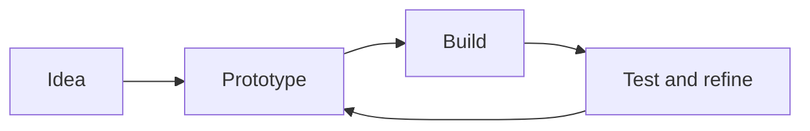

<div align="center">

# Hey, I'm Mr1Err0r1 👋

**I like turning small ideas into things people can play with.**

Building with **Godot** and the web · Currently learning **Java, Python & Rust**

`2 public projects` · `3 languages on my learning list` · `cat person`

</div>

---

## About me

- I enjoy making creative, interactive projects.
- I’m currently learning Java, Python, and Rust.
- I use he/him pronouns.
- Cats are always welcome.
- Contact: keeping it private for now.

## Projects

### [rush_protocol](https://github.com/Mr1Err0r1/rush_protocol)
A game project made with **Godot 4.7**.

### [terminal-heart](https://github.com/Mr1Err0r1/terminal-heart)
A self-contained retro terminal experience for the browser, with animations, mini-games, and a lo-fi soundtrack.

## How I like to build



## A tiny terminal companion

```text
 /\_/\
( o.o )   hello, world!
 > ^ <
```

---

<div align="center">

*Curious, learning, and building one project at a time.*

</div>
