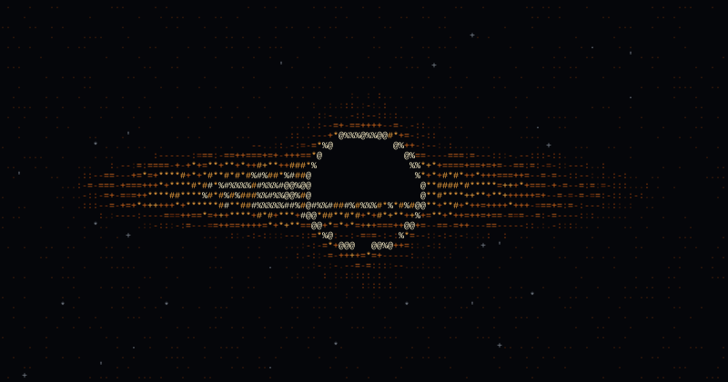

<div align="center">


<br><br>



<!-- Alternative: replace the line above with your GIF

-->

</div>

<!-- ASCII PORTRAIT: paste it here inside a ```text block, e.g. centered under the black hole -->

## > whoami

```text
mr1err0r1@github:~$ whoami
Mr1Err0r1 — developer · builder · computer science student

mr1err0r1@github:~$ cat focus.txt
game development · systems programming · networking

mr1err0r1@github:~$ cat stack.txt
primary      Rust, Python
also         Java, C++, C#
environment  Linux, Git, terminal-first workflow

mr1err0r1@github:~$ cat now.txt
building     rush_protocol (Godot 4.7)
deepening    Rust · Python · Java
```

## > stack

<p>
  
</p>

## > projects

| Project | Description | Tech |
| :-- | :-- | :-- |
| [**rush_protocol**](https://github.com/Mr1Err0r1/rush_protocol) | Game project | Godot 4.7 |
| [**terminal-heart**](https://github.com/Mr1Err0r1/terminal-heart) | Self-contained retro terminal experience for the browser: animations, mini-games and a lo-fi soundtrack | Web |

## > activity

<div align="center">


<!-- Snake: appears after the "Generate snake" workflow has run once -->
<picture>
  <source media="(prefers-color-scheme: dark)" srcset="https://raw.githubusercontent.com/Mr1Err0r1/Mr1Err0r1/output/github-snake-dark.svg">
  <source media="(prefers-color-scheme: light)" srcset="https://raw.githubusercontent.com/Mr1Err0r1/Mr1Err0r1/output/github-snake.svg">
  
</picture>

</div>

---

<div align="center">

```text
$ git commit -m "keep building"
```

</div>
